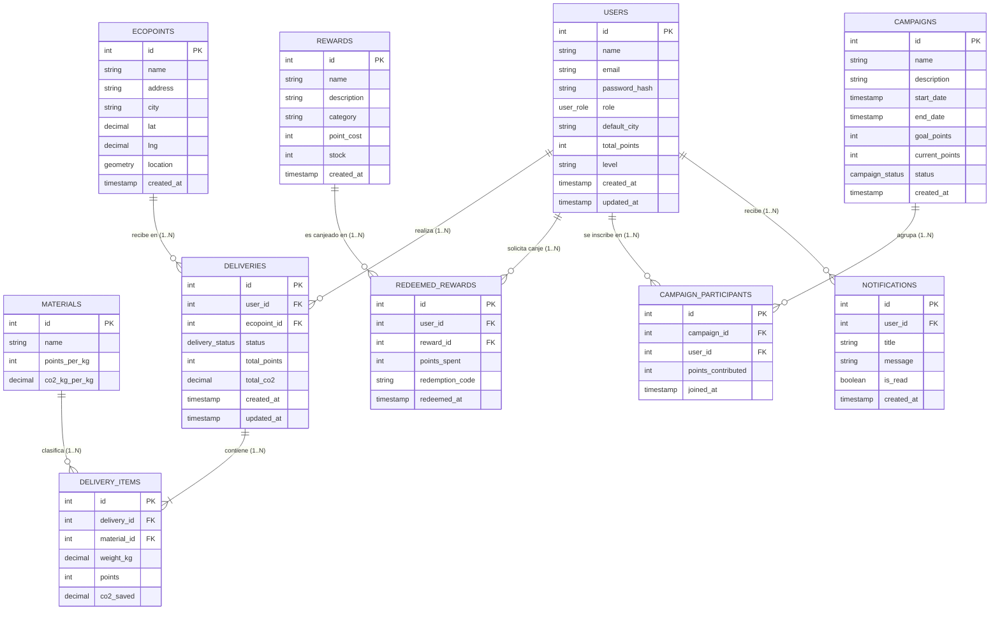

# Documentación de Base de Datos y Normalización: EcoPuntos Pamplona

Este documento constituye la evidencia técnica oficial para cumplir con los criterios **5 (Diseño y Diagrama de Base de Datos - 8 pts)** y **6 (Normalización de Tablas - 7 pts)** de la Rúbrica de Evaluación de Desarrollo Orientado a Plataformas.

---

## 1. Diagrama Entidad-Relación (ERD)

El siguiente diagrama representa el esquema relacional de la base de datos de **EcoPuntos Pamplona**, implementada sobre **PostgreSQL 15 con extensión espacial PostGIS 3.3**.

---

## 2. Proceso de Normalización de Tablas

A continuación se demuestra la aplicación de las tres primeras formas normales (**1FN, 2FN y 3FN**) usando la estructura de datos del proyecto **EcoPuntos Pamplona**.

### 2.1. Primera Forma Normal (1FN)
*Regla: Los atributos deben ser atómicos (no divisibles), y no deben existir grupos ni listas repetitivas de valores dentro de una sola celda.*

- **Problema sin 1FN:** Si en una entrega un usuario recicla plástico, vidrio y cartón al mismo tiempo, guardar los materiales como una lista o cadena separada por comas (`materials: "Plástico, Vidrio"`) o arreglos dentro de la tabla `deliveries` violaría la 1FN.
- **Solución implementada:** Se aisló el detalle de los materiales entregados en la tabla de detalle `delivery_items`. Cada fila representa **un único material con su peso correspondiente (`weight_kg`)** vinculado a la entrega cabecera `deliveries.id`. No existen columnas repetidas (`material1`, `material2`) ni tipos complejos desestructurados en la entidad principal.

### 2.2. Segunda Forma Normal (2FN)
*Regla: Debe estar en 1FN y todo atributo que no sea clave debe depender funcionalmente de la clave primaria completa (sin dependencias parciales).*

- **Problema sin 2FN:** Si los atributos de los materiales como `points_per_kg` (puntos por kilo) y `co2_kg_per_kg` (CO₂ ahorrado por kilo) se almacenaran dentro de `delivery_items`, esos valores dependerían del tipo de material y no del ID de la fila de la entrega.
- **Solución implementada:** Se creó la entidad independiente `materials`, donde se registran las propiedades intrínsecas de cada material reciclable. La tabla `delivery_items` solo referencia a `material_id` como Clave Foránea (FK), garantizando que la configuración de puntos y CO₂ de cada material tenga una única fuente de verdad.

### 2.3. Tercera Forma Normal (3FN)
*Regla: Debe estar en 2FN y no deben existir dependencias transitivas (ningún atributo no clave debe depender de otro atributo no clave).*

- **Problema sin 3FN:** En la tabla `deliveries`, si guardáramos la dirección del Ecopunto (`ecopoint_address`) o el nombre del usuario (`user_name`), estos campos dependerían de `ecopoint_id` o `user_id`, y no directamente de la clave primaria `deliveries.id`. Si el Ecopunto cambiara de dirección, habría que actualizar múltiples registros en entregas.
- **Solución implementada:** Se removieron todos los atributos transitivos de `deliveries`. Únicamente se almacenan las claves foráneas `user_id` y `ecopoint_id`. Los datos demográficos y geográficos pertenecen exclusivamente a las tablas `users` y `ecopoints`.

---

## 3. Justificación de Entidades Intermedias y Desnormalización Controlada

### 3.1. Justificación de `campaign_participants` (Relación N..N)
Entre `users` y `campaigns` existe una relación de **Muchos a Muchos (N..N)**: un usuario puede participar en múltiples campañas ecológicas, y una campaña agrupa a múltiples usuarios participantes. Para modelar esta relación sin romper la 1FN se implementó la tabla asociativa `campaign_participants` con una restricción de clave única compuesta `UNIQUE(campaign_id, user_id)`. Adicionalmente, esta tabla almacena el atributo derivado `points_contributed` para registrar el aporte específico de cada participante dentro de esa campaña.

### 3.2. Decisión de Desnormalización Controlada por Rendimiento
Las columnas `total_points` y `total_co2` en la tabla `deliveries`, así como `total_points` en la tabla `users`, almacenan valores calculados. 
- **Justificación Técnica:** Se optó por mantener estos campos actualizados mediante **transacciones atómicas (ACID)** en la capa de aplicación durante la aprobación de cada entrega. Esto evita la ejecución repetitiva de consultas pesadas con agregaciones SQL (`SUM()`, `JOIN`) en pantallas de alto tráfico como el Ranking de Usuarios, la consulta de saldo del perfil y el historial de entregas.
