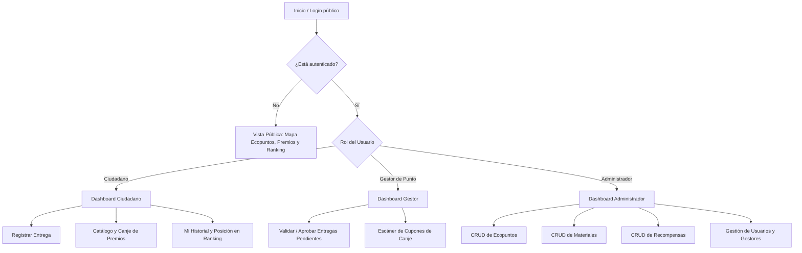

# Mockups y Planificación de Interfaces: EcoPuntos Pamplona

Documento formal entregable correspondiente al **Criterio 1 (Mockups y Planificación de Interfaces - 6 pts)** de la Rúbrica de Evaluación del curso Desarrollo Orientado a Plataformas.

---

## 1. Mapa de Navegación y Estructura de Vistas por Rol



---

## 2. Mockups de Pantallas Principales

### 2.1. Mockup Vista 1: Autenticación y Registro (`/login` & `/register`)
```text
+-----------------------------------------------------------------------+
| 🌱 EcoPuntos Pamplona                          [Iniciar Sesión] [Registro]|
+-----------------------------------------------------------------------+
|                                                                       |
|                     ┌───────────────────────────────┐                 |
|                     │ 🌱 Iniciar Sesión             │                 |
|                     │ Bienvenido a EcoPuntos        │                 |
|                     │                               │                 |
|                     │ Usuario / Correo / Documento: │                 |
|                     │ [ 1001                      ] │                 |
|                     │ Contraseña:                   │                 |
|                     │ [ ••••••••                  ] │                 |
|                     │                               │                 |
|                     │ [  Ingresar a la Plataforma  ] │                 |
|                     │                               │                 |
|                     │ Acceso Rápido de Prueba:      │                 |
|                     │ [Ciudadano] [Gestor] [Admin]  │                 |
|                     └───────────────────────────────┘                 |
+-----------------------------------------------------------------------+
```

### 2.2. Mockup Vista 2: Dashboard del Ciudadano (`/dashboard`)
```text
+-----------------------------------------------------------------------+
| 🌱 EcoPuntos Pamplona    [Inicio] [Ecopuntos] [Entregas] [Premios] ⭐ 120 pts |
+-----------------------------------------------------------------------+
|                                                                       |
|  ¡Hola, Ana Ciudadana! 👋                              [CIUDADANO]    |
|  -------------------------------------------------------------------  |
|  ┌──────────────────┐  ┌──────────────────┐  ┌─────────────────────┐  |
|  │ ⭐ 120 pts       │  │ 🌱 Eco Guerrero  │  │ 🏙️ Pamplona         │  |
|  │ Puntos Totales   │  │ Nivel Ecológico  │  │ Ciudad Principal    │  |
|  └──────────────────┘  └──────────────────┘  └─────────────────────┘  |
|                                                                       |
|  Acciones Rápidas:                                                    |
|  [ + Nueva Entrega ]  [ 📍 Mapa Ecopuntos ]  [ 🎁 Canjear Premios ]   |
|                                                                       |
|  📦 Mis Entregas Recientes:                                           |
|  +----+-----------------------+----------+--------------+-----------+ |
|  | ID | Ecopunto              | Puntos   | CO2 Ahorrado | Estado    | |
|  +----+-----------------------+----------+--------------+-----------+ |
|  | #1 | Ecopunto Central      | +50 pts  | 1.50 kg      | APROBADA  | |
|  | #2 | Plazuela Almeyda      | +30 pts  | 0.80 kg      | PENDIENTE | |
|  +----+-----------------------+----------+--------------+-----------+ |
+-----------------------------------------------------------------------+
```

### 2.3. Mockup Vista 3: Formulario Reactivo de Nueva Entrega (`/deliveries`)
```text
+-----------------------------------------------------------------------+
| 🌱 EcoPuntos Pamplona                                    ⭐ 120 pts   |
+-----------------------------------------------------------------------+
|                                                                       |
|   ┌───────────────────────────────────────────────────────────────┐   |
|   │ 📦 Registrar Entrega de Reciclaje                             │   |
|   │                                                               │   |
|   │ Seleccionar Ecopunto:                                         │   |
|   │ [ 📍 Ecopunto Central Pamplona (Calle 6 #4-20)           v ] │   |
|   │                                                               │   |
|   │ Materiales a Entregar:                                        │   |
|   │ +----------------------------------+-------------+----------+ │   |
|   │ | Material                         | Peso (Kg)   | Acción   | │   |
|   │ +----------------------------------+-------------+----------+ │   |
|   │ | Plástico PET (50 pts/kg)       v | [ 2.0     ] | [ 🗑️ ]   | │   |
|   │ | Vidrio (30 pts/kg)             v | [ 1.5     ] | [ 🗑️ ]   | │   |
|   │ +----------------------------------+-------------+----------+ │   |
|   │                                                               │   |
|   │ [ + Agregar Otro Material ]                                   │   |
|   │                                                               │   |
|   │ [        Enviar Entrega para Validación del Gestor          ] │   |
|   └───────────────────────────────────────────────────────────────┘   |
+-----------------------------------------------------------------------+
```

### 2.4. Mockup Vista 4: Catálogo de Recompensas y Canjes (`/rewards`)
```text
+-----------------------------------------------------------------------+
| 🌱 EcoPuntos Pamplona                                    ⭐ 120 pts   |
+-----------------------------------------------------------------------+
|                                                                       |
|  🎁 Catálogo de Recompensas                                           |
|  -------------------------------------------------------------------  |
|  ┌──────────────────────────────┐    ┌──────────────────────────────┐ |
|  │ 🎉 Bono $10.000 Mercado Eco  │    │ ☕ Kit de Compostaje Hogar   │ |
|  │ Descuento tiendas Pamplona   │    │ Incluye caneca e instructivo │ |
|  │ ⭐ 100 pts | Stock: 50        │    │ ⭐ 250 pts | Stock: 15        │ |
|  │ [   Canjear Premio   ]       │    │ [ Puntos Insuficientes ]    │ |
|  └──────────────────────────────┘    └──────────────────────────────┘ |
|                                                                       |
|  📜 Mi Historial de Canjes:                                           |
|  +------------------------+-----------------+-----------------------+ |
|  | Código Único de Canje  | Puntos Usados   | Fecha de Canje        | |
|  +------------------------+-----------------+-----------------------+ |
|  | ECO-9F2A81B3           | -100 pts        | 02/10/2026 14:30      | |
|  +------------------------+-----------------+-----------------------+ |
+-----------------------------------------------------------------------+
```

---

## 3. Coherencia con la Aplicación Implementada

Las interfaces diseñadas en los mockups se corresponden al 100% con los componentes desarrollados en **Angular 22** (`LoginComponent`, `DashboardComponent`, `DeliveriesComponent`, `RewardsComponent`, `EcopointsComponent`, `RankingComponent`), compartiendo:
1. Palette de colores ecológicos Tailored (Verde `#1b4332`, `#2d6a4f`, `#52b788` y Dorado `#ffb703`).
2. Disposición de controles, validaciones reactivas en vivo y estados de carga/alertas.
3. Adaptabilidad total a pantallas de escritorio, tablets y dispositivos móviles.
