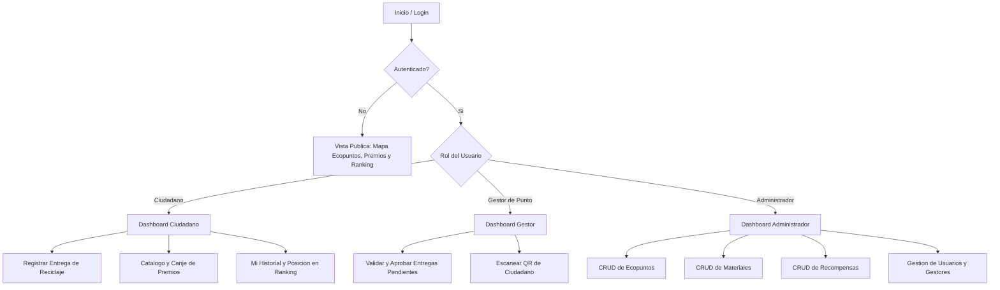

# EcoPuntos Pamplona — Sistema de Incentivos de Reciclaje

Plataforma web de reciclaje para la ciudad de **Pamplona, Norte de Santander (Colombia)**, desarrollada para el curso **Desarrollo Orientado a Plataformas** de la Universidad de Pamplona.

**Stack Tecnologico:**
- **Frontend:** Angular 22 (Standalone Components, TypeScript, ReactiveForms, Interceptores, Guards)
- **Backend:** FastAPI 0.142 (Python 3.13, Pydantic v2, SQLAlchemy 2.1, JWT, Uvicorn)
- **Base de Datos:** PostgreSQL 15 + PostGIS 3.3 (Docker)

---

## Como funciona la aplicacion

El acceso y las funcionalidades disponibles dependen del rol del usuario autenticado:



---

## Documentacion del Proyecto

| Documento | Descripción |
|---|---|
| [`Plan_Implementacion_EcoPuntos_Angular_FastAPI.md`](./Plan_Implementacion_EcoPuntos_Angular_FastAPI.md) | Documento de planeación e implementación actualizado con el stack Angular + FastAPI |
| [`Plan_Migracion_EcoPuntos_Angular_FastAPI.md`](./Plan_Migracion_EcoPuntos_Angular_FastAPI.md) | Plan de migracion tecnologica del stack anterior al stack Angular + FastAPI |
| [`Documento_BD_Normalizacion_EcoPuntos.md`](./Documento_BD_Normalizacion_EcoPuntos.md) | Diagrama ERD (Mermaid) + Normalización 1FN, 2FN, 3FN con las tablas del sistema |
| [`Guia_Sustentacion_Defensa_EcoPuntos.md`](./Guia_Sustentacion_Defensa_EcoPuntos.md) | Guía de sustentación y respuestas a preguntas frecuentes del docente |
| [`mockups_EcoPuntos/mockups/`](./mockups_EcoPuntos/mockups/) | Imagenes PNG de todas las pantallas del sistema (19 vistas por rol) |

---

## Guia de Ejecucion Local

### Prerrequisitos
- **Node.js** v20+
- **Python** 3.11+
- **Docker Desktop** (activo)

### Paso 1 — Iniciar la Base de Datos

```bash
docker-compose up -d
```

Servicios que se levantan:
- **PostgreSQL 15 + PostGIS 3.3** en `localhost:5432`
- **pgAdmin 4** en `http://localhost:5050` (usuario: `admin@ecopuntos.com`, contraseña: `admin`)

### Paso 2 — Configurar y Arrancar el Backend FastAPI

```bash
cd fastapi_backend

# Sembrar datos de prueba iniciales (materiales, ecopuntos, usuarios, recompensas)
python seed.py

# Iniciar servidor de desarrollo
python -m uvicorn app.main:app --reload --port 3000
```

La **API REST** queda disponible en:
- Endpoints: `http://localhost:3000/api/...`
- **Swagger UI (Documentación interactiva):** `http://localhost:3000/docs`
- ReDoc: `http://localhost:3000/redoc`

### Paso 3 — Iniciar el Frontend Angular

```bash
cd frontend
npx ng serve --port 4200
```

Abrir en el navegador: **`http://localhost:4200`**

---

## Ejecutar Pruebas Automatizadas

```bash
cd fastapi_backend
python -m pytest tests/ -v
```

Resultados esperados:
```
tests/test_api.py ...    [ 75%]
tests/test_system.py .   [100%]

4 passed, 1 warning in 1.51s
```

La suite `test_system.py` cubre los 8 flujos integrales del sistema:
1. Autenticación de Administrador
2. Registro Público de Ciudadano
3. Creación de Gestor de Punto por Admin
4. Flujo de Código QR (generación + escaneo)
5. Registro y aprobación de entrega de reciclaje
6. Verificación de saldo persistente en PostgreSQL
7. Canje de recompensa por cupón
8. Ranking público y métricas ejecutivas del Admin

---

## Credenciales de Usuarios de Prueba

| Rol | Documento / Correo | Contraseña | Acceso |
|---|---|---|---|
| **Administrador** | `9001` ó `admin@ecopuntos.com` | `admin123` | Panel completo: CRUD de Ecopuntos, Materiales, Recompensas, Métricas globales |
| **Gestor de Punto** | `2002` ó `gestor@ecopuntos.com` | `gestor123` | Validación y aprobación de entregas, escáner QR |
| **Ciudadano** | `1001` ó `eco@ecopuntos.com` | `eco123` | Registro de entregas, canje de premios, ranking |

---

## Puertos del Sistema

| Servicio | Puerto | URL |
|---|---|---|
| Frontend Angular | 4200 | `http://localhost:4200` |
| Backend FastAPI (API) | 3000 | `http://localhost:3000/api/` |
| FastAPI Swagger UI | 3000 | `http://localhost:3000/docs` |
| PostgreSQL / PostGIS | 5432 | `localhost:5432` (BD: `ecopuntos`, usuario: `postgres`) |
| pgAdmin 4 | 5050 | `http://localhost:5050` |

---

## Estructura del Proyecto

```
ECOPUNTOS PAMPLONA/
├── frontend/                     ← Angular 22 (Standalone Components)
│   └── src/app/
│       ├── core/
│       │   ├── models/           ← Interfaces TypeScript (User, Delivery, Reward...)
│       │   ├── services/         ← AuthService, DeliveryService, RewardService...
│       │   ├── interceptors/     ← AuthInterceptor (JWT), ErrorInterceptor
│       │   └── guards/           ← AuthGuard, RoleGuard
│       ├── shared/               ← NavbarComponent
│       └── features/             ← LoginComponent, DashboardComponent,
│                                    DeliveriesComponent, RewardsComponent,
│                                    EcopointsComponent, RankingComponent
├── fastapi_backend/              ← FastAPI + SQLAlchemy + Pydantic v2
│   ├── app/
│   │   ├── main.py               ← App FastAPI, CORS, routers
│   │   ├── config.py             ← Variables de entorno (Pydantic Settings)
│   │   ├── database.py           ← Motor SQLAlchemy + Sesión
│   │   ├── security.py           ← bcrypt, JWT, get_current_user, require_roles
│   │   ├── models/models.py      ← Modelos ORM (10 tablas)
│   │   ├── schemas/schemas.py    ← Schemas Pydantic v2 (entrada/salida)
│   │   └── routers/              ← auth, ecopoints, materials, deliveries,
│   │                                rewards, ranking, admin, qr
│   ├── tests/
│   │   ├── test_api.py           ← Tests básicos
│   │   └── test_system.py        ← Suite integral de 8 flujos
│   └── seed.py                   ← Datos de prueba iniciales
├── backend/                      ← Sistema original Express (referencia)
│   └── migrations/               ← Esquema SQL original (reutilizado)
├── Documento_BD_Normalizacion_EcoPuntos.md
├── Mockups_Planificacion_Interfaces_EcoPuntos.md
├── Plan_Implementacion_EcoPuntos_Angular_FastAPI.md
├── Plan_Migracion_EcoPuntos_Angular_FastAPI.md
├── Guia_Sustentacion_Defensa_EcoPuntos.md
├── docker-compose.yml
└── README.md
```

---
