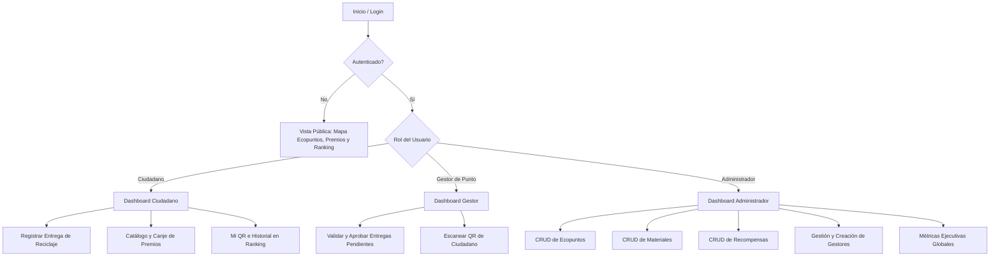

# EcoPuntos Pamplona — Sistema de Incentivos de Reciclaje

Plataforma web de reciclaje para la ciudad de **Pamplona, Norte de Santander (Colombia)**, desarrollada para el curso **Desarrollo Orientado a Plataformas** de la Universidad de Pamplona.

**Stack Tecnológico:**
- **Frontend:** Angular 17+ (Standalone Components, TypeScript, ReactiveForms, Interceptores, Guards)
- **Backend:** FastAPI 0.100+ (Python 3.13, Pydantic v2, SQLAlchemy 2.0+, JWT, Uvicorn)
- **Base de Datos:** PostgreSQL 15 + PostGIS 3.3 (Docker) / Resiliencia SQLite

---

## Cómo funciona la aplicación

El acceso y las funcionalidades disponibles dependen del rol del usuario autenticado:



---

## Documentación del Proyecto

| Documento | Descripción |
|---|---|
| [`Plan_Implementacion_EcoPuntos_Angular_FastAPI.md`](./Plan_Implementacion_EcoPuntos_Angular_FastAPI.md) | Documento de planeación e implementación actualizado con el stack Angular + FastAPI |
| [`Plan_Migracion_EcoPuntos_Angular_FastAPI.md`](./Plan_Migracion_EcoPuntos_Angular_FastAPI.md) | Plan de migración tecnológica del stack anterior al stack Angular + FastAPI |
| [`Documento_BD_Normalizacion_EcoPuntos.md`](./Documento_BD_Normalizacion_EcoPuntos.md) | Diagrama ERD (Mermaid) + Normalización 1FN, 2FN, 3FN con las tablas del sistema |
| [`Guia_Sustentacion_Defensa_EcoPuntos.md`](./Guia_Sustentacion_Defensa_EcoPuntos.md) | Guía de sustentación y respuestas a preguntas frecuentes del docente |

---

## Guía de Ejecución Local

### Prerrequisitos
- **Node.js** v20+
- **Python** 3.11+
- **Docker Desktop** (opcional para PostgreSQL en container)

### Paso 1 — Iniciar la Base de Datos

```bash
docker-compose up -d
```

Servicios levantados:
- **PostgreSQL 15 + PostGIS 3.3** en `localhost:5432`
- **pgAdmin 4** en `http://localhost:5050` (usuario: `admin@ecopuntos.com`, contraseña: `admin`)

> **Nota sobre Migraciones vs DDL Directo:** Las tablas de la base de datos se crean automáticamente mediante `Base.metadata.create_all(bind=engine)` al ejecutar el script de seed (`seed_completo.py`). Se optó por esta arquitectura DDL declarativa en SQLAlchemy en lugar de usar Alembic para acelerar la inicialización reproducible del entorno local.

### Paso 2 — Configurar y Arrancar el Backend FastAPI

```bash
cd fastapi_backend

# 1. Crear e iniciar entorno virtual Python
python -m venv .venv
# En Windows PowerShell:
.venv\Scripts\Activate.ps1
# En Linux/macOS:
# source .venv/bin/activate

# 2. Instalar dependencias
pip install -r requirements.txt

# 3. Sembrar datos de prueba iniciales (materiales, ecopuntos, usuarios, recompensas, entregas)
python seed_completo.py

# 4. Iniciar servidor de desarrollo
python -m uvicorn app.main:app --reload --port 3000
```

La **API REST** queda disponible en:
- Endpoints: `http://localhost:3000/api/...`
- **Swagger UI (Documentación interactiva):** `http://localhost:3000/docs`
- ReDoc: `http://localhost:3000/redoc`

### Paso 3 — Iniciar el Frontend Angular

```bash
cd frontend
npx ng serve --port 4200
```

Abrir en el navegador: **`http://localhost:4200`**

---

## Ejecutar Pruebas Automatizadas

### Backend (Pytest)
```bash
cd fastapi_backend
python -m pytest tests/ -v
```

Resultados esperados:
```
tests/test_api.py::test_health_check PASSED                              [ 11%]
tests/test_api.py::test_unauthorized_access_to_profile PASSED            [ 22%]
tests/test_api.py::test_public_ecopoints_list PASSED                     [ 33%]
tests/test_error_cases.py::test_error_401_unauthorized_without_token PASSED [ 44%]
tests/test_error_cases.py::test_error_403_forbidden_citizen_calling_admin_endpoint PASSED [ 55%]
tests/test_error_cases.py::test_error_422_invalid_payload_data PASSED    [ 66%]
tests/test_error_cases.py::test_error_404_nonexistent_resource PASSED    [ 77%]
tests/test_error_cases.py::test_error_insufficient_points_for_reward PASSED [ 88%]
tests/test_system.py::test_full_system_flow PASSED                       [100%]

======================== 9 passed in 7.75s =========================
```

La suite cubre los 9 flujos de éxito y casos de error del sistema:
1. Verificación de estado de salud (Health Check)
2. Manejo de error 401 sin token o token inválido
3. Manejo de error 403 cuando un ciudadano llama a endpoints de admin
4. Manejo de error 422 con datos o estructuras de payload inválidas
5. Manejo de error 404 al consultar o eliminar recursos inexistentes
6. Manejo de error 400 en canjes con saldo de puntos insuficiente
7. Autenticación y creación de gestores por administrador
8. Flujo completo de Código QR (generación + escaneo)
9. Integración continua de entregas, saldo en BD, canje y ranking

### Frontend (Karma / Jasmine)
```bash
cd frontend
ng test
```

---

## Credenciales de Usuarios de Prueba

| Rol | Correo | Contraseña | Acceso |
|---|---|---|---|
| **Administrador** | `admin@ecopuntos.com` | `admin123` | CRUD de Ecopuntos, Materiales, Recompensas, Métricas, Crear Gestor |
| **Gestor de Punto** | `gestor@ecopuntos.com` | `gestor123` | Validación y aprobación de entregas, escáner QR |
| **Ciudadano (1° Ranking)** | `ana@ecopuntos.com` | `eco123` | Registro de entregas, canje de premios, carnet QR, ranking |
| **Ciudadano (2° Ranking)** | `juan@ecopuntos.com` | `eco123` | Historial de entregas, catálogo de recompensas |

---

## Puertos del Sistema

| Servicio | Puerto | URL |
|---|---|---|
| Frontend Angular | 4200 | `http://localhost:4200` |
| Backend FastAPI (API) | 3000 | `http://localhost:3000/api/` |
| FastAPI Swagger UI | 3000 | `http://localhost:3000/docs` |
| PostgreSQL / PostGIS | 5432 | `localhost:5432` (BD: `ecopuntos`, usuario: `postgres`) |
| pgAdmin 4 | 5050 | `http://localhost:5050` |

---

## Estructura del Proyecto

```
ECOPUNTOS PAMPLONA/
├── frontend/                     ← Angular 17+ (Standalone Components)
│   └── src/app/
│       ├── core/
│       │   ├── models/           ← User, Delivery, EcoPoint, Material, Reward
│       │   ├── services/         ← AuthService, DeliveryService, EcoPointService,
│       │   │                        MaterialService, RewardService, AdminService, QrService
│       │   ├── interceptors/     ← AuthInterceptor (JWT), ErrorInterceptor
│       │   └── guards/           ← AuthGuard, RoleGuard
│       ├── shared/               ← NavbarComponent (Navegación dinámica por rol)
│       └── features/             ← Admin (Metrics, Gestor, EcoPoints, Materials, Rewards),
│                                    Gestor (Scan), Citizen (QR), Dashboard, Deliveries,
│                                    EcoPoints Detail, Ranking, Rewards
├── fastapi_backend/              ← FastAPI + SQLAlchemy 2.0 + Pydantic v2
│   ├── app/
│   │   ├── main.py               ← App FastAPI, CORSMiddleware, routers
│   │   ├── config.py             ← Pydantic BaseSettings
│   │   ├── database.py           ← Motor SQLAlchemy con resiliencia SQLite
│   │   ├── security.py           ← passlib (bcrypt), python-jose (JWT), require_roles
│   │   ├── models/models.py      ← Modelos ORM relacionales
│   │   ├── schemas/schemas.py    ← DTOs / Schemas Pydantic v2
│   │   └── routers/              ← auth, ecopoints, materials, deliveries,
│   │                                rewards, ranking, admin, qr
│   ├── tests/
│   │   ├── test_api.py           ← Tests de salud y endpoints públicos
│   │   ├── test_error_cases.py   ← Tests de respuestas de error (401, 403, 422, 404, 400)
│   │   └── test_system.py        ← Test de integración end-to-end completo
│   ├── requirements.txt          ← Dependencias Python con versiones
│   └── seed_completo.py          ← Inicialización DDL y sembrado de datos
├── legacy/                       ← Código legado de versión anterior (Node.js/Express)
├── Documento_BD_Normalizacion_EcoPuntos.md
├── Plan_Implementacion_EcoPuntos_Angular_FastAPI.md
├── Guia_Sustentacion_Defensa_EcoPuntos.md
├── docker-compose.yml
├── start.js                      ← Script de arranque rápido (FastAPI + Angular)
└── package.json                  ← Scripts npm raíz
```
